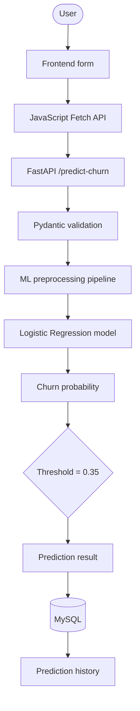

<div align="center">

# ChurnIQ

**Customer churn prediction, from form to forecast.**


</div>

---

## Overview

ChurnIQ is an end-to-end customer churn prediction application. It combines Machine Learning, Python backend development, REST APIs, MySQL database integration and a web frontend in a single project.

Enter a customer's demographic, service, contract and billing information, and ChurnIQ returns:

- Whether the customer is likely to churn
- The probability of churn
- A stored prediction history in MySQL

## Problem statement

Customer churn hurts revenue and retention. Identifying customers who are likely to leave lets an organization take retention action in time.

ChurnIQ analyzes customer information and predicts the likelihood of churn through a REST API and a web interface.

## Objectives

- Clean and preprocess customer data
- Perform exploratory data analysis
- Train and compare multiple Machine Learning models
- Evaluate models using classification metrics
- Analyze classification thresholds
- Build a reusable Machine Learning pipeline
- Develop a REST API using FastAPI and validate requests with Pydantic
- Store prediction results in MySQL
- Develop a frontend using HTML, CSS and JavaScript
- Display prediction probability and prediction history

---

## Features

| Area | What it includes |
|---|---|
| **Machine Learning** | Data cleaning and preprocessing, categorical encoding, numerical handling, model training and evaluation (Logistic Regression, Random Forest, XGBoost), ROC-AUC, threshold analysis, saved Scikit-learn pipeline |
| **Backend** | FastAPI REST API, Pydantic validation, prediction endpoint, health-check endpoint, prediction history endpoint, CORS configuration, SQLAlchemy integration |
| **Database** | MySQL storage for prediction history, customer information and prediction probability |
| **Frontend** | Responsive interface, customer information form, churn probability visualization, prediction result page, prediction history table, Fetch API integration |

## Technology stack

| Layer | Technologies |
|---|---|
| Languages | Python, JavaScript, HTML, CSS, SQL |
| Machine Learning | Pandas, NumPy, Scikit-learn, XGBoost, Joblib |
| Backend | FastAPI, Uvicorn, Pydantic, SQLAlchemy, PyMySQL |
| Database | MySQL |
| Tools | Visual Studio Code, Git, GitHub |

---

## Machine Learning workflow


## Dataset

ChurnIQ uses the **IBM Telco Customer Churn** dataset.

| Stage | Shape |
|---|---|
| Original | 7,043 rows × 21 columns |
| After cleaning | 7,010 rows × 20 columns |

- The `customerID` column was removed because it carries no predictive information.
- Missing values in `TotalCharges` were handled after converting the column to numeric.
- The target variable is `Churn`: `0` means the customer stays, `1` means the customer churns.

## Model evaluation

Three models were evaluated:

| Model | Accuracy | Precision | Recall | F1 Score | ROC-AUC |
|---|---:|---:|---:|---:|---:|
| **Logistic Regression** ✅ | **81.55%** | **68.65%** | **55.83%** | **61.58%** | **85.12%** |
| Random Forest | 79.74% | 66.09% | 48.29% | 55.81% | 82.86% |
| XGBoost | 79.84% | 65.65% | 50.09% | 56.82% | 84.67% |

Based on this evaluation, **Logistic Regression** was selected for the final prediction pipeline.

## Threshold analysis

The default threshold of 0.50 was analyzed to see how different thresholds change precision and recall.

| Threshold | Precision | Recall | F1 Score |
|---:|---:|---:|---:|
| 0.30 | 54.02% | 75.94% | 63.13% |
| **0.35** ✅ | **57.22%** | **71.81%** | **63.69%** |
| 0.40 | 59.87% | 65.35% | 62.49% |
| 0.45 | 64.44% | 60.50% | 62.41% |
| 0.50 | 68.65% | 55.83% | 61.58% |

A threshold of **0.35** was selected for the application because it has the highest F1 score among the tested thresholds. It is applied in the prediction service, so the trained model itself is unchanged.

---

## Application flow



## API endpoints

| Method | Endpoint | Description |
|---|---|---|
| `GET` | `/` | Confirms that the API is running |
| `GET` | `/health` | Checks whether the backend service is healthy |
| `POST` | `/predict-churn` | Accepts customer information and returns the churn prediction and probability |
| `GET` | `/predictions` | Returns previously stored prediction records from MySQL |

Example response from `POST /predict-churn`:

```json
{
  "churn_prediction": 1,
  "churn_probability": 0.8199,
  "result": "Customer is likely to churn"
}
```

## Database

- **Database:** `customer_churn_db`
- **Main table:** `predictions`

Stored information: customer gender, tenure, contract, internet service, online security, technical support, payment method, monthly charges, total charges, churn prediction, churn probability and paperless billing.

---

## Project structure

<details>
<summary>Show the folder tree</summary>

```text
customer-churn-api/
│
├── app/
│   ├── main.py
│   ├── config.py
│   ├── database.py
│   ├── models.py
│   │
│   ├── schemas/
│   │   └── prediction.py
│   │
│   └── services/
│       └── prediction_service.py
│
├── artifacts/
│   └── churn_pipeline.joblib
│
├── data/
│   ├── raw/
│   └── processed/
│
├── frontend/
│   ├── index.html
│   ├── style.css
│   └── script.js
│
├── ml/
│   ├── inspect_data.py
│   ├── clean_data.py
│   ├── eda.py
│   ├── prepare_data.py
│   ├── preprocessing.py
│   ├── test_preprocessing.py
│   ├── train.py
│   ├── evaluate.py
│   ├── threshold_analysis.py
│   └── save_model.py
│
├── docs/
│   └── churniq-flow.svg
│
├── .gitignore
├── README.md
└── requirements.txt
```

</details>

## Installation and setup

**1. Clone the repository**

```bash
git clone <YOUR_GITHUB_REPOSITORY_URL>
cd customer-churn-api
```

**2. Create a virtual environment** (Windows)

```bash
python -m venv .venv
.venv\Scripts\activate
```

**3. Install dependencies**

```bash
pip install -r requirements.txt
```

**4. Set up MySQL**

```sql
CREATE DATABASE customer_churn_db;
```

The application connects to MySQL through SQLAlchemy and PyMySQL.

**5. Configure the database connection**

Set the connection according to your local MySQL configuration.

> [!WARNING]
> Do not commit database passwords or other credentials to GitHub.

**6. Start the FastAPI backend**

From the project root:

```bash
uvicorn app.main:app --reload
```

- API: <http://127.0.0.1:8000>
- Swagger docs: <http://127.0.0.1:8000/docs>

**7. Run the frontend**

Open `frontend/index.html` with a local development server such as the VS Code Live Server extension. The frontend communicates with the FastAPI backend.

---

## Current status

- [x] Machine Learning based churn prediction
- [x] FastAPI REST APIs
- [x] MySQL prediction storage
- [x] Frontend customer input
- [x] Churn probability visualization
- [x] Prediction history

The application is currently configured for local execution.

## Future enhancements

- [ ] Deploy the application for public access
- [ ] Add authentication and authorization
- [ ] Add customer-level analytics
- [ ] Add interactive business dashboards
- [ ] Add model monitoring
- [ ] Add automated retraining
- [ ] Improve frontend filtering and search
- [ ] Add cloud deployment

---

## Author

**Monika**
B.Tech in Computer Science and Engineering (AI & ML)
